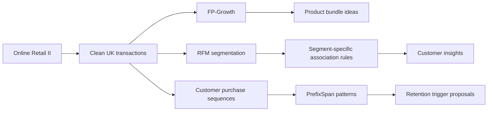

<div align="center">

# From Clicks to Loyalty
### Customer Intelligence Through Data Mining

**Discover co-purchases. Understand customers. Explore retention signals.**


[Explore the Notebook](i232634_DS-A_Assignment2_Solution.ipynb) · [Read the Report](i232634_DS-A_Assignment2_Report.pdf) · [Get Started](#getting-started)

</div>

---

## Overview

An academic customer intelligence pipeline built on **UCI Online Retail II** transaction data. The analysis connects market basket patterns with customer segments and purchase histories to propose gift bundles and retention actions.

The repository contains the original executed notebook and accompanying PDF report for **DS-3002 Data Mining — Assignment 2**.

## The pipeline



| Stage | Approach | Output |
| :--- | :--- | :--- |
| **Prepare** | Combine both workbook sheets; remove cancellations, non-positive quantities/prices, and missing customer IDs; retain UK transactions | A consistent transaction baseline |
| **Part A · Co-purchases** | FP-Growth with 2% minimum support and 50% minimum confidence | Frequent itemsets, ranked association rules, and gift bundle ideas |
| **Part B · Customer segments** | Recency, frequency, and monetary value; segment-specific mining at 1% support and 55% confidence | Champion, At-Risk, and One-and-Done profiles; sample basket rule matching |
| **Part C · Purchase journeys** | Keyword-based product categories and PrefixSpan over invoice category tuples | Frequent purchase sequences and proposed retention triggers |

## Results at a glance

The following figures come from the **saved notebook outputs**, rather than a new execution.

| Cleaned dataset | Recorded value |
| :--- | ---: |
| Transaction rows | **725,250** |
| Unique invoices | **33,541** |
| Customers | **5,350** |
| Products | **4,616** |
| Average distinct products per invoice | **20.57** |
| Observation window | **1 Dec 2009 – 9 Dec 2011** |

### Co-purchase highlight

**Sweetheart Ceramic Trinket Box → Strawberry Ceramic Trinket Box**

| Support | Confidence | Lift |
| :---: | :---: | :---: |
| **2.36%** | **72.20%** | **14.10×** |

At the configured thresholds, the saved run contains **193 frequent single-item sets** and **28 frequent two-item sets**.

### Customer segmentation

| Segment | Customers | Average invoices per customer |
| :--- | ---: | ---: |
| Champion | 620 | 23.48 |
| At-Risk | 3,458 | 5.05 |
| One-and-Done | 1,272 | 1.18 |

The saved sequential mining run reports **3,933 frequent sequences** across all customers and **763** within the At-Risk group.

## Repository guide

```text
clicks-to-loyalty-data-mining/
├── i232634_DS-A_Assignment2_Solution.ipynb  # Analysis with saved outputs
├── i232634_DS-A_Assignment2_Report.pdf      # Written assignment report
├── README.md                              # Project guide
├── requirements.txt                       # Runtime and notebook dependencies
└── .gitignore                             # Local environments and cache exclusions
```

## Getting started

### 1. Set up Python

The notebook metadata records **Python 3.13.1**. The dependency list provides package names without claiming an exact, locked reproduction of the original environment.

```bash
git clone https://github.com/Saif1Shahzad/clicks-to-loyalty-data-mining.git
cd clicks-to-loyalty-data-mining
python -m venv .venv
```

Activate the environment:

```powershell
# Windows PowerShell
.\.venv\Scripts\Activate.ps1
```

```bash
# macOS / Linux
source .venv/bin/activate
```

Install the dependencies:

```bash
python -m pip install -r requirements.txt
```

### 2. Add the dataset

Obtain the **Online Retail II** Excel workbook from the UCI Machine Learning Repository and place it in the repository root using this exact filename:

```text
online_retail_II.xlsx
```

The first notebook cell loads sheets **0** and **1** and concatenates them. The workbook is **not included** in this repository; the original folder contains the notebook and report only.

### 3. Open the notebook

```bash
jupyter lab i232634_DS-A_Assignment2_Solution.ipynb
```

Select the environment's Python kernel and run the cells from top to bottom. The saved outputs can also be inspected directly on GitHub, and the PDF report can be read without installing Python.

## Interpretation notes

- **Segment labels are heuristic.** Customers who do not meet the Champion or One-and-Done conditions also default to At-Risk, so that label covers a broader group than confirmed churn.
- **Part B mines product-to-product rules within segments.** Its sample basket scores are rule confidences, not calibrated probabilities of segment membership. The saved interpretation text and printed scores are not fully consistent; consult the actual outputs when drawing conclusions.
- **Sequence events are complete category tuples.** PrefixSpan treats each invoice tuple as one sequence element; this is not category-subset itemset sequence mining.
- **Trigger confidence needs care.** The implementation divides subsequence support by start-of-history prefix support, which uses different matching criteria. Treat the resulting values and monthly estimates as exploratory calculations.
- **Retention actions are proposals.** Suggested discount vouchers are not validated intervention outcomes or a deployed churn prediction system.

## Academic context

**Course:** DS-3002 Data Mining<br>
**Assignment:** 2<br>
**Submission identifier:** i232634 · DS-A

The notebook contains the implementation and saved analysis; the PDF provides the accompanying written submission. No software license has been added.
